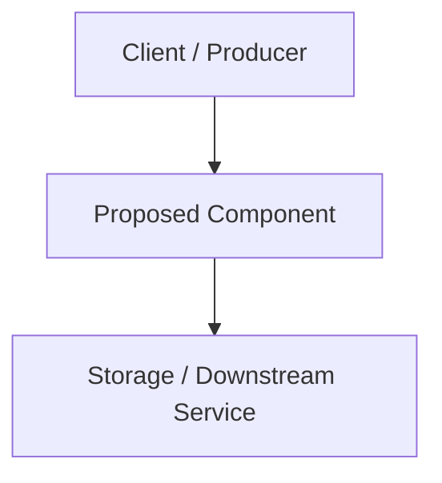

---
# ============================================================================
# Managed section — preserve the document metadata when updating this file
# ============================================================================
id: RFC-0000
type: rfc
title: "Descriptive title of the technical proposal"
status: draft
created_at: YYYY-MM-DD
updated_at: YYYY-MM-DD
# ============================================================================
authors:
  - "@author"
reviewers: []
related_prds: []
tags: []
---

# RFC-0000: Descriptive title of the technical proposal

## Executive Summary

Provide a concise (1–2 paragraphs) summary explaining what is being proposed and the expected value.

## Motivation

- What problem are we solving?
- Why is it important to solve it now?
- Who are the affected users, services, or workflows?

## Goals and Non-Goals

### Goals (In-Scope)
- Measurable objective 1
- Measurable objective 2

### Non-Goals (Out-of-Scope)
- What this proposal explicitly **will not** address

## Detailed Design / Proposal

Describe the proposed technical solution in sufficient depth for engineering review:
- High-level architecture (Mermaid diagrams encouraged)
- Data model changes, API contracts, or public interfaces
- Core execution flows and error handling strategies

## Impact, Risks, and Compatibility

- **Breaking Changes**: Does this break backward compatibility? How will migration be handled?
- **Security & Privacy**: Authentication, authorization, data protection, or attack-surface considerations.
- **Performance & Operations**: Resource usage, observability, metrics, and rollout strategy.

## Alternatives Considered

### Alternative A: [Name]
- **Description**: Brief overview of the alternative approach.
- **Reason for Rejection**: Why the primary proposal was chosen instead.

## Open Questions

- [ ] Open question 1 to be resolved during review
- [ ] Open question 2

## Adoption Plan & Follow-up Artifacts

Once this RFC is approved (`status: approved`), create the following downstream artifacts:

- **ADRs to Create**:
  - [ ] `ADR-NNNN`: [Title of architectural decision derived from this RFC]
- **Specs to Create**:
  - [ ] `SPEC-NNNN`: [Title of executable specification for implementation]
- **Runbooks to Create / Update**:
  - [ ] `RUNBOOK-NNNN`: [Title of operational procedure derived from this RFC]
