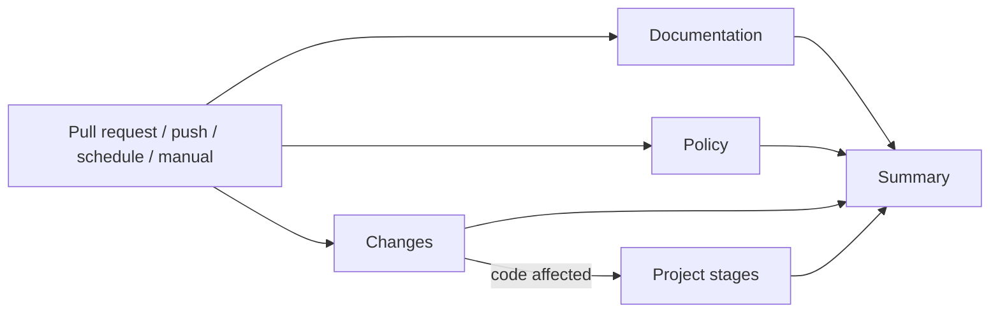

---
# ============================================================================
# Managed section — preserve the document metadata when updating this file
# ============================================================================
id: SPEC-0001
type: spec
title: "CI pipeline"
status: draft
created_at: 2026-11-11
updated_at: 2026-11-11
# ============================================================================
owners:
  - "@sjgarani"
related_prds: []
related_rfcs: []
related_adrs: [ADR-0001, ADR-0002, ADR-0003]
tags: [ci, github-actions, documentation, quality]
---

# SPEC-0001: CI pipeline

## Overview and Objective

Specify the GitHub Actions pipeline ([ADR-0003](../adrs/0003-use-github-actions-for-ci.md)) that every
project adopting doc2gh builds in its own repository. On every pull request and every push to `main`, it
checks the shape of the framework documents, the rules set by the ADRs, and the repository settings, and
shows on the pull request what failed and which document the broken rule comes from. Each project writes
the scripts and the workflow from this Spec; doc2gh does not ship them. The pipeline has generic stages
(documentation, policy, and summary) and extension points for the project's own stages, such as builds and
tests.

## AI Agent Context

> Direct instructions to guide AI coding assistants when reading context and generating code for this specification.

- **Affected Modules / Directories**:
  - `.github/workflows/ci.yml`: the workflow, which only calls the scripts (template in Technical
    Design, section 2)
  - `ci/`: `ci_common.py`, `check-docs`, `check-policy`, `affects-code`, and `summary`
  - `ci/tests/`: tests for the scripts
  - `ci/.gitignore`: ignores `__pycache__/`
- **Applicable Mandatory ADRs**:
  - `ADR-0001`: document shape, owners, and traceability (rules 1, 5, 6, and 7)
  - `ADR-0002`: branch names and repository merge settings (rules 2, 3, and 4)
  - `ADR-0003`: workflow security (rules 1 to 5), required stages, and informational checks (rule 6)
- **Verification / Test Commands**:
  - `ci/check-docs`
  - `ci/check-policy` (`--offline` to skip the GitHub API)
  - `GITHUB_TOKEN=$(gh auth token) ci/check-policy` to check the repository settings with an
    admin's credentials
  - `python3 -m unittest discover --start-directory ci/tests`

## Functional Requirements

- **FR-01**: The pipeline must run on every pull request to `main`, on every push to `main`
  ([ADR-0002](../adrs/0002-branching-and-merge-workflow.md), rule 1), on a daily schedule against `main`
  at 06:00 UTC, and on manual dispatch, as in the workflow template (section 2).
- **FR-02**: **Documentation** stage (`check-docs`). It examines every `*.md` file at the top level of
  `<docs>/<type>/`, where the types are `prds`, `rfcs`, `adrs`, `specs`, and `runbooks`, except
  `README.md` and `template.md`. For each one it must check that:
  - the file name matches `NNNN-<title>.md`, where `NNNN` runs from `0001` to `9999` and `<title>` is
    lowercase letters and digits separated by single hyphens, and the number is unique within the
    directory;
  - the front matter parses (Technical Design, section 1);
  - `id` is `<PREFIX>-NNNN`, where the prefix belongs to the directory's type (`PRD`, `RFC`, `ADR`,
    `SPEC`, or `RUNBOOK`) and the number comes from the file name, and the `id` is unique across all
    documents;
  - `type` matches the directory (`prd`, `rfc`, `adr`, `spec`, or `runbook`);
  - every front matter field in the type's `template.md` is present;
  - the status is listed in the type's lifecycle table: the first table in the `README.md` section whose
    heading starts with `## Lifecycle` (English framework) or `## Ciclo de vida` (Portuguese framework),
    taking the backticked value in the first column of each row;
  - `created_at` and `updated_at` are valid `YYYY-MM-DD` dates, `updated_at` is not earlier than
    `created_at`, and `last_verified_at`, where the type's template has it, is empty or a valid date;
  - every ID in `related_*`, `supersedes`, and `superseded_by` matches
    `^(PRD|RFC|ADR|SPEC|RUNBOOK)-[0-9]{4}$` and exists;
  - an ADR is `superseded` if and only if `superseded_by` is set;
  - an `active` Runbook has `last_verified_at` set;
  - every item in `deciders` and `owners` is a GitHub login written as `@login`, matching
    `^@[A-Za-z0-9](?:[A-Za-z0-9-]*[A-Za-z0-9])?$` ([ADR-0001](../adrs/0001-link-the-documentation-framework-to-github.md),
    rule 5);
  - the first line after the front matter, outside fenced code blocks, that starts with `# ` equals
    `# <id>: <title>`, with backticks removed from both;
  - every relative link resolves (link rule in section 2).

  Files that are not `*.md`, subdirectories of a type directory, and files outside the type directories
  (such as `<docs>/README.md`) are not examined. A missing type directory, `README.md`, `template.md`, or
  lifecycle table is a violation. A missing `<docs>` directory is an execution error (exit `2`).

  Every FR-02 violation names SPEC-0001 as its source, except the owner check, which names ADR-0001. A
  duplicated number or `id` is reported on each file involved. A document whose front matter does not
  parse gets that one violation: its other checks are skipped, and its `id` does not count for
  references. A `template.md` whose front matter does not parse is a violation located at that file.
- **FR-03**: **Policy** stage (`check-policy`), workflow rules
  ([ADR-0003](../adrs/0003-use-github-actions-for-ci.md), rules 2 to 5). For every `.yml` or `.yaml` file
  at the top level of `.github/workflows/`, read as described in section 2, it must check that:
  - there is a top-level `permissions:` key in block form whose only entry is `contents: read`;
    job-level `permissions` are not examined;
  - every `uses:` that points outside the repository has the form `<owner>/<action>[/<path>]@<sha>`,
    where `<sha>` is 40 lowercase hexadecimal characters, followed on the same line by a non-empty
    comment carrying the version; every `docker://` reference ends in `@sha256:` plus 64 hexadecimal
    characters and needs no version comment; local actions (`./`) are exempt;
  - a workflow that uses `actions/checkout` does not list `pull_request_target` among its `on:` events,
    in any form (scalar, list, or key);
  - every step that uses `actions/checkout` sets `persist-credentials: false` in its `with:` block.
- **FR-04**: **Policy** stage, repository settings (ADR-0002, rules 3 and 4):
  - The repository is taken from `GITHUB_REPOSITORY` (`<owner>/<repo>`) or, when that is unset, from the
    `origin` remote URL on `github.com` (HTTPS or SSH). If neither is available, the script stops with an
    execution error (exit `2`).
  - It calls `GET <api>/repos/<owner>/<repo>`, where `<api>` is `GITHUB_API_URL` (default
    `https://api.github.com`; GitHub Actions already sets it), sending `GITHUB_TOKEN` as `Authorization: Bearer <token>` when it is set.
  - It checks that `allow_merge_commit` and `delete_branch_on_merge` are `true` and that
    `allow_squash_merge` and `allow_rebase_merge` are `false`. Each mismatch is a violation located at
    `repos/<owner>/<repo>`.
  - If the response lacks any of the four fields or has one set to `null`, or the API answers 401, 404,
    or a 403 that is not a rate limit, nothing is checked and the script prints the note
    `repository settings not checked` without failing; [RUNBOOK-0001](../runbooks/0001-configure-the-github-repository.md)
    covers the check instead. With `--offline`, the call is skipped and the note reads
    `repository settings not checked (--offline)`.
  - Any other failure (a 5xx or 429 answer, an exhausted rate limit, a network error, or a response that
    is not JSON) is an execution error (exit `2`).
- **FR-05**: **Policy** stage, project rules. Each project ADR whose compliance section calls for an
  automated check adds that rule to the project's `check-policy`, and every violation names that ADR as
  its source.
- **FR-06**: Project stages (builds, unit tests, integration tests, and so on). The Spec that introduces
  the code to be checked adds a script to `ci/` and a job to `ci.yml` that only calls it (as in
  the template), and adds the job ID to the summary's `--required` once the code exists (FR-08). If the
  stage only runs when code is affected, it also adds the job ID to `--gated` and its paths to
  `CODE_PATHS` in `affects-code` (FR-07). If `main` is already protected, the same Spec adds the new
  required stage to the protection (RUNBOOK-0001, Step 4).
- **FR-07**: **Changes** job (`affects-code`). It prints `code=true` or `code=false` as its only standard
  output, and the reason on standard error.
  - Code is affected when a file changed between `BASE` and `HEAD`
    (`git diff --name-only BASE...HEAD`) matches an entry of the `CODE_PATHS` constant at the top of the script. An entry ending
    in `/` matches that directory and everything below it; any other entry is matched against the path
    with `fnmatch`. `CODE_PATHS` always includes `ci/` and `.github/workflows/`, never includes
    `docs/`, and gains the paths of each slow stage. Files under `docs/` are dropped before matching, so
    a pattern such as `*.md` never makes a documentation change count as code. `git` runs at the
    repository root, matching uses `fnmatchcase`, and an empty diff means `code=false`. All gated stages
    share this single flag; no stage can narrow it to its own paths.
  - It also prints `code=true` for any event other than `pull_request` and `push` (such as `schedule` and `workflow_dispatch`), when
    `BASE` is empty or all zeros, and when `git diff` fails. `affects-code` always exits with `0`, and an empty `HEAD` means `HEAD`.
  - The documentation and policy stages always run. Only projects with slow stages need this job.
- **FR-08**: A required stage is one that must pass before a merge (ADR-0003, rule 6). `docs` and
  `policy` are required from day one; each project stage becomes required as soon as the code it checks
  exists. A stage with nothing to check yet succeeds and says so.
- **FR-09**: **Summary** job (`summary --required <ids> [--gated <ids>]`, where each list holds job IDs
  separated by commas, with no spaces; an ID uses only letters, digits, `_`, and `-`, and a list with an
  empty or repeated item is malformed). It reads the `NEEDS` variable and, on every run, including after
  an earlier failure:
  - writes a `## CI stages (SPEC-0001)` heading and a `| Stage | Required | Result |` table, one row per
    job: first the `--required` jobs in that order, then any other job in `NEEDS`. The Stage column holds
    the job ID; Required holds `yes` or `no`; Result holds `passed`, `failed`, `cancelled`, `skipped`,
    `skipped (code not affected)`, or `missing` (a required job absent from `NEEDS`);
  - treats a required stage as passed only if its result is `success`, or if it is `skipped`, appears in
    `--gated`, and the `changes` job has result `success` and output `code` equal to `false`;
  - ends with "All required stages passed." (exit `0`) or "A required stage did not pass: do not merge
    (ADR-0003, rule 6)." (exit `1`);
  - appends everything to `$GITHUB_STEP_SUMMARY` when it is set, and to standard output. The summary does
    not use the violation format;
  - exits with `2`, with the message on standard error, when `NEEDS` is not a JSON object whose values each
    hold a `result`, or when an ID list is malformed. An unknown result value is shown as is.
- **FR-10**: **Policy** stage, branch name (ADR-0002, rule 2). When `GITHUB_EVENT_NAME` is
  `pull_request`, `GITHUB_HEAD_REF` must match `^(docs|feat|fix|ci|chore)/[a-z0-9]+(-[a-z0-9]+)*$`; a
  mismatch is a violation located at `branch <name>`. Other events skip this check. An empty
  `GITHUB_HEAD_REF` on a `pull_request` event is an execution error (exit `2`). The check needs no API,
  so it also runs with `--offline`.

## Non-Functional Requirements & Constraints

- **NFR-01 (Response time)**: stages that always run must report back quickly: at most 1 minute per job
  and at most 3 minutes from run creation to completion, runner queue included. Each job's
  `timeout-minutes` is the hard limit: 10 minutes for `docs` and `policy`, 5 minutes for `changes` and
  `summary`. Project stages set their own targets in the Spec that introduces them.
- **NFR-02 (Cost)**: private repositories spend plan minutes. Slow stages run only when code is affected
  (FR-07). Pull request runs share one concurrency group per pull request and cancel the previous run;
  every other run gets a group of its own and is never cancelled, so no run for a push to `main` is lost
  (ADR-0003, rule 7). The exact expression is in the template.
- **NFR-03 (Reproducibility)**: scripts use only the Python 3.10+ standard library and produce the same
  result locally as in CI. Jobs run on `ubuntu-24.04` with the system `python3`, without
  `actions/setup-python`.
- **NFR-04 (Security)**: ADR-0003, rules 2 to 5 and 8. `GITHUB_TOKEN` is passed as an environment
  variable only to the `check-policy` step; checkouts use the action's default token without persisting
  it. `GITHUB_TOKEN` is not a repository secret: on pull requests from forks it is read-only, and
  `check-policy` receives it as usual.
- **NFR-05 (Diagnosability)**: every violation names the document that defines the rule, the location,
  and the line when the violation concerns one line (format in section 2).

## Technical Design

### 1. Data Models / Entities

Nothing is persisted and no artifacts are published.

**Front matter**: the lines between a first line holding `---` and the next line holding `---`. Allowed
lines: blank lines; comments (a line whose first non-blank character is `#`); `key: value`, where the value
is unquoted or wrapped in single or double quotes; `key: [a, b]`, a flow list of such values; and `key:`
with nothing after it, followed by zero or more `  - value` lines, forming a block list (empty when no
item follows). Anything else is a violation reported on its line: nested maps, multi-line values, a
repeated key, a list item outside a list, or a missing closing `---`, reported on
line 1. A space followed by `#` after a value or a flow list starts a trailing comment, which is dropped. Keys
match `[A-Za-z_][A-Za-z0-9_]*`; list items are indented by at least one space, and blank or comment lines
may sit between them; quoted values are taken literally, with no escapes. `deciders`, `owners`,
`supersedes`, `tags`, and every `related_*` field are lists; every other field is a single value; a field
of the wrong kind is a violation.

**Inputs**, besides the repository files:

| Script | Environment variable | Content |
| :--- | :--- | :--- |
| `check-policy` | `GITHUB_REPOSITORY`, `GITHUB_API_URL`, `GITHUB_TOKEN` | Repository to read, API base URL, and token (FR-04). |
| `check-policy` | `GITHUB_EVENT_NAME`, `GITHUB_HEAD_REF` | Event and pull request branch (FR-10). |
| `affects-code` | `EVENT`, `BASE`, `HEAD` | Event name, base commit, and commit under test (FR-07). |
| `summary` | `NEEDS`, `GITHUB_STEP_SUMMARY` | The workflow's `needs` context as JSON, and the summary file (FR-09). |

### 2. Interfaces / APIs / Contracts

Jobs in `ci.yml`. Display names are in English because they double as the status check names in the
protection on `main` (RUNBOOK-0001); the summary table shows job IDs.

| Job (`id`) | Display name | Command | When it runs | Required | `timeout-minutes` |
| :--- | :--- | :--- | :--- | :--- | :--- |
| `changes` | Changes | `ci/affects-code >> "$GITHUB_OUTPUT"` | Always, if there is a slow stage | No (gates the slow stages) | 5 |
| `docs` | Documentation | `ci/check-docs` | Always | Yes | 10 |
| `policy` | Policy | `python3 -m unittest discover --start-directory ci/tests --verbose` and `ci/check-policy` | Always | Yes | 10 |
| Project stage | Set by its Spec | Script in `ci/` | Always, or when code is affected | Once its code exists (FR-08) | Set by its Spec |
| `summary` | Summary | `ci/summary --required <ids> --gated <ids>` | Always (`if: always()`) | Not applicable | 5 |

Contract shared by `check-docs` and `check-policy`:

- Exit code `0` on success, `1` with violations, and `2` on an execution error, whose message goes to
  standard error.
- Each violation is one line on standard output: `[<source document>] <location>[:<line>]: <message>`.
  The source document is the ADR or Spec that defines the rule. The location is a path relative to the
  root, `repos/<owner>/<repo>` (FR-04), or `branch <name>` (FR-10). The line is present only when the
  violation concerns a single line. Example:
  `[ADR-0003] .github/workflows/ci.yml:30: action actions/checkout@v4 is not pinned to a commit SHA`.
- Notes go to standard output as `<script>: <note>`, before the violations, which are sorted by location
  and line. An execution error prints `<script>: error: <message>` on standard error. Files are read as
  UTF-8; a file that is not valid UTF-8 is a violation. The last line is `<script>: ok` on success, or
  `<script>: 1 violation` / `<script>: <n> violations` on failure.
- Messages are in English, like the code.
- `--root <directory>`: root of the repository to check; by default, the repository holding the script
  (`git -C <script directory> rev-parse --show-toplevel`).
- `check-docs --docs <directory>`: directory holding the document types, relative to the root (default
  `docs`; `.` in the framework's own repository).
- `check-policy --offline`: skips the GitHub API (FR-04).

**Link rule** (`check-docs`): it considers inline links and images (`[text](target)`,
``) and reference definitions (`[label]: target`), outside fenced code blocks (opened by
three backticks or three tildes) and inline code. Targets with a scheme (`https:`, `mailto:`, and so on)
and pure anchors (`#...`) are skipped; any `#fragment` is dropped and not checked. A target wrapped in `<...>` is unwrapped, and `%XX`
escapes are decoded before resolving. A link title (`[text](target "title")`) and any `?query` are
dropped. Whether a target leaves the root is decided on the normalized path, without following symlinks.
The front matter is not scanned for links. A target starting with
`/` resolves from the root; any other target resolves from the document's directory. A target that does
not exist, or that resolves outside the root, is a violation.

**Reading workflows** (`check-policy`): line by line, without a YAML library. A top-level key starts at
column zero. Outside quotes, `#` at the start of a line or after a space starts a comment, and the version comment of
FR-03 is read from it. The
body of a block scalar (`run: |`, `run: >`) is skipped by indentation. Steps and `with:` blocks are
written in block style: a step written as a flow mapping (`- { ... }`) or a `with:` written as a flow
mapping is a violation that names SPEC-0001, since this reader cannot check it. Flow values elsewhere, such as a job-level `permissions: {}`, are
allowed.

**Workflow template** (`<sha>` and `<version>` per Task 4; the `hello` job stands for a project stage
that only runs when code is affected; without slow stages, drop `changes`, the project job, and
`--gated`):

```yaml
# CI pipeline (SPEC-0001, ADR-0003). The checks live in ci/;
# this file only calls them.
name: CI

on:
  pull_request:
    branches: [main]
  push:
    branches: [main]
  schedule:
    - cron: "0 6 * * *"
  workflow_dispatch:

permissions:
  contents: read

concurrency:
  group: ci-${{ github.event_name == 'pull_request' && format('pr-{0}', github.event.pull_request.number) || format('run-{0}', github.run_id) }}
  cancel-in-progress: ${{ github.event_name == 'pull_request' }}

jobs:
  changes:
    name: Changes
    runs-on: ubuntu-24.04
    timeout-minutes: 5
    outputs:
      code: ${{ steps.detect.outputs.code }}
    steps:
      - uses: actions/checkout@<sha> # <version>
        with:
          persist-credentials: false
          fetch-depth: 0
      - id: detect
        env:
          EVENT: ${{ github.event_name }}
          BASE: ${{ github.event.pull_request.base.sha || github.event.before }}
          HEAD: ${{ github.sha }}
        run: ci/affects-code >> "$GITHUB_OUTPUT"

  docs:
    name: Documentation
    runs-on: ubuntu-24.04
    timeout-minutes: 10
    steps:
      - uses: actions/checkout@<sha> # <version>
        with:
          persist-credentials: false
      - run: ci/check-docs

  policy:
    name: Policy
    runs-on: ubuntu-24.04
    timeout-minutes: 10
    steps:
      - uses: actions/checkout@<sha> # <version>
        with:
          persist-credentials: false
      - run: python3 -m unittest discover --start-directory ci/tests --verbose
      - run: ci/check-policy
        env:
          GITHUB_TOKEN: ${{ github.token }}

  hello:
    name: Hello
    needs: changes
    if: needs.changes.outputs.code == 'true'
    runs-on: ubuntu-24.04
    timeout-minutes: 5
    steps:
      - uses: actions/checkout@<sha> # <version>
        with:
          persist-credentials: false
      - run: ci/hello

  summary:
    name: Summary
    if: always()
    needs: [changes, docs, policy, hello]
    runs-on: ubuntu-24.04
    timeout-minutes: 5
    steps:
      - uses: actions/checkout@<sha> # <version>
        with:
          persist-credentials: false
          sparse-checkout: ci
      - env:
          NEEDS: ${{ toJSON(needs) }}
        run: ci/summary --required docs,policy,hello --gated hello
```



### 3. Execution Flow & Edge Cases

- **Pull request from a fork**: runs without repository secrets; stages that need one are skipped
  (ADR-0003, rule 4). The read-only `GITHUB_TOKEN` still reaches `check-policy` (NFR-04).
- **Framework files** (each type's `README.md` and `template.md`, and the files at the root of
  `<docs>`): not examined at all, neither metadata nor links (FR-02).
- **Documentation-only pull request**: the slow stages do not run, and the summary shows them as
  `skipped (code not affected)`.
- **Stage with nothing to check yet**: succeeds and says there is nothing to check (FR-08).
- **Repository settings hidden from the API**, which may happen with the CI token: the
  `repository settings not checked` note, no failure (FR-04).
- **No `GITHUB_REPOSITORY` and no GitHub `origin`** (for example, a local repository): `check-policy`
  exits with `2` unless it runs with `--offline`.
- **GitHub API down or rate limit exhausted**: `check-policy` exits with `2`. Re-run once; if it keeps
  failing, follow [RUNBOOK-0002](../runbooks/0002-diagnose-and-fix-ci-pipeline-failures.md).
- **Commits that cannot be compared** (shallow history, force push): `affects-code` prints `code=true`
  (FR-07).
- **Merge with a failing required stage, or a direct push to `main`** (both possible without branch
  protection): the run for the push to `main` shows the failure, which is fixed as ADR-0003, rule 7
  describes.
- **Flaky failure**: record it and investigate. Re-run only failures from outside the code, by hand, and
  at most once per failure; never retry automatically without a limit.

## Acceptance Criteria

- [ ] **AC-01**: Given a document with a duplicate number, a status outside its lifecycle, or a broken
  relative link, when the pipeline runs, then the documentation stage fails, naming SPEC-0001 and the
  file.
- [ ] **AC-02**: Given a document missing a template field, with an owner not written as `@login`, or
  whose H1 differs from `# <id>: <title>`, when the pipeline runs, then the documentation stage fails.
- [ ] **AC-03**: Given a workflow without top-level `permissions: contents: read`, with an action
  referenced by tag or without a version comment, or with a checkout lacking
  `persist-credentials: false`, when the pipeline runs, then the policy stage fails, naming ADR-0003 and,
  for violations on a line, that line.
- [ ] **AC-04**: Given a workflow with both `pull_request_target` and `actions/checkout`, when the
  pipeline runs, then the policy stage fails.
- [ ] **AC-05**: Given a repository with `allow_squash_merge` on and a token that can read it, when
  `check-policy` runs, then it fails, naming ADR-0002; given a token that cannot read it, it passes and
  prints `repository settings not checked`.
- [ ] **AC-06**: Given a pull request that only touches `docs/`, when the pipeline runs, then the slow
  stages are skipped and the summary ends with "All required stages passed.".
- [ ] **AC-07**: Given a run with a failing required stage, when the summary job runs, then it shows that
  stage as `failed` and exits with `1`.
- [ ] **AC-08**: Given any script in `ci/`, when it runs locally on the same commit, then it
  produces the same result as in CI.
- [ ] **AC-09**: Given a scheduled or manual run, when the pipeline runs, then every stage runs.
- [ ] **AC-10**: Given a pull request from a branch named outside `<type>/<short-topic>`, when the
  pipeline runs, then the policy stage fails, naming ADR-0002 and the branch.

## Task Breakdown (AI Execution)

Incremental, verifiable implementation steps:

- [ ] **Task 1**: Implement `ci/ci_common.py` (front matter parsing, violation format, exit
  codes, default root) and `check-docs` (FR-02), with tests in `ci/tests/`
- [ ] **Task 2**: Implement `check-policy` with the workflow rules (FR-03), the repository settings check
  (FR-04), and the branch name check (FR-10), with tests that use a local fake API through
  `GITHUB_API_URL`
- [ ] **Task 3**: Implement `summary` (FR-09) and, if the project has a stage that only runs when code is
  affected, `affects-code` (FR-07), with tests
- [ ] **Task 4**: Write `.github/workflows/ci.yml` from the template in section 2. For each action, use
  the latest release (`gh api repos/<owner>/<action>/releases/latest --jq .tag_name`) pinned to the SHA
  of its tag (`gh api repos/<owner>/<action>/commits/<tag> --jq .sha`), with the tag as the comment
- [ ] **Task 5**: When the plan allows branch protection, register the required stages as required status
  checks on `main` (RUNBOOK-0001)
- [ ] **Task 6**: Measure the duration of the always-on stages and confirm the NFR-01 targets
- [ ] **Task 7**: Write the Runbook for diagnosing pipeline failures
  ([RUNBOOK-0002](../runbooks/0002-diagnose-and-fix-ci-pipeline-failures.md))

## Test & Verification Plan

- **Unit Tests**: every `check-docs` and `check-policy` rule, with valid and invalid cases in temporary
  repositories created by the tests; the front matter subset, including its invalid forms; the link rule;
  `check-policy` against a local fake API (settings readable, hidden, and mismatched); `affects-code` with
  each event type, matching and non-matching paths, empty or all-zero `BASE`, and a failing `git diff`;
  `summary` with passed, failed, cancelled, missing, gated-and-skipped, and skipped-for-another-reason
  stages.
- **Integration / E2E Tests**: test pull requests that break each rule (AC-01 to AC-07 and AC-10) and one
  manual run (AC-09).
- **Manual Verification**: compare a local run of each script with the CI log of the same commit (AC-08);
  before each merge, confirm in the summary job that every required stage
  passed; once branch protection is in place, confirm that those stages show up as required on the pull
  request.
